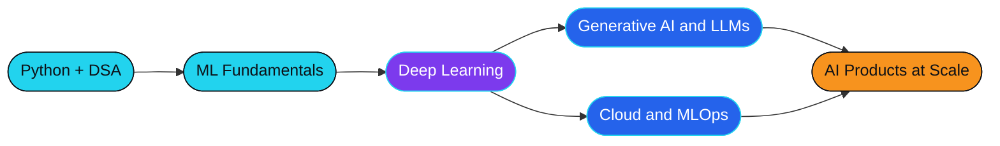

<div align="center">


<br/>

<a href="https://github.com/ANMOLGOLA"></a>
<a href="https://linkedin.com/in/anmolgola66571"></a>
<a href="https://www.instagram.com/anmolgola.in"></a>
<a href="https://anmol-gola-portfolio.vercel.app/"></a>
<br/><br/>


</div>

<br/>

<div align="center">

</div>

---

## ⚡ BOOT SEQUENCE

<table>
<tr>
<td width="55%" valign="top">

### 👨‍💻 About Me

Hey! I'm **Anmol Gola**, an aspiring AI/ML developer who loves turning raw data and wild ideas into working, intelligent products.

- 🎓 **B.Tech CSE (AI & ML)** at GLA University
- 📊 **BS in Data Science** at IIT Madras
- 🤖 Deep into **Machine Learning and Generative AI**
- ☁️ Exploring **Cloud Computing and DevOps**
- 🧩 Sharpening **DSA** every single day
- 🌍 Passionate about **open source** and developer communities

</td>
<td width="45%" valign="top">

### 🖥️ Developer Terminal

```bash
anmol@github:~$ whoami
> AI/ML Developer | Problem Solver

anmol@github:~$ cat focus.txt
> AI & Machine Learning
> Data Science
> Cloud Technologies
> Open Source

anmol@github:~$ echo $MOTTO
> "Build something that matters."

anmol@github:~$ _
```

</td>
</tr>
</table>

<div align="center">

**Think Beyond Limits. Build With Purpose. Innovate Without Boundaries.**

</div>

---

## 🧰 TECH ARSENAL

<div align="center">

<br/><br/>
<br/><br/>
<br/><br/>
<br/><br/>
<br/><br/>


</div>

<details>
<summary><b>🔎 Click to expand: skill levels at a glance</b></summary>
<br/>

| Skill | Level |
|---|---|
| Python |  |
| Machine Learning |  |
| Deep Learning |  |
| Data Science / Analysis |  |
| Web Development |  |
| Cloud & DevOps |  |

*Adjust the numbers to match your honest level.*

</details>

---

## 🐍 CONTRIBUTION SNAKE

<div align="center">
<picture>
  <source media="(prefers-color-scheme: dark)" srcset="https://raw.githubusercontent.com/ANMOLGOLA/ANMOLGOLA/output/github-snake-dark.svg" />
  <source media="(prefers-color-scheme: light)" srcset="https://raw.githubusercontent.com/ANMOLGOLA/ANMOLGOLA/output/github-snake.svg" />
  
</picture>
</div>

---

## 📊 LIVE STATS

<div align="center">


<br/>


<br/>


</div>

### 🏆 Trophy Cabinet

<div align="center">

</div>

---

## 🚀 FEATURED PROJECTS

> Replace `REPO_NAME_1` to `REPO_NAME_4` with your best repositories. Each card is clickable.

<div align="center">

<a href="https://github.com/ANMOLGOLA/REPO_NAME_1"></a>
<a href="https://github.com/ANMOLGOLA/REPO_NAME_2"></a>
<a href="https://github.com/ANMOLGOLA/REPO_NAME_3"></a>
<a href="https://github.com/ANMOLGOLA/REPO_NAME_4"></a>

</div>

<details>
<summary><b>📁 Click to see project details (add your own)</b></summary>
<br/>

| Project | What it does | Stack | Result |
|---|---|---|---|
| **Project 1** | One-line problem it solves | Python, scikit-learn | 94% accuracy |
| **Project 2** | One-line problem it solves | PyTorch, CNN | F1 0.91 |
| **Project 3** | One-line problem it solves | LLMs, Hugging Face | Live demo |
| **Project 4** | One-line problem it solves | Streamlit, Pandas | Deployed |

</details>

---

## 🗺️ MY LEARNING ROADMAP



<div align="center"><sub>🟦 Done &nbsp;•&nbsp; 🟪 In progress &nbsp;•&nbsp; 🔵 Up next &nbsp;•&nbsp; 🟧 Goal</sub></div>

---

## 🎯 CURRENT MISSIONS

- [x] Build solid Python and ML foundations
- [ ] Master Deep Learning with PyTorch
- [ ] Ship a Generative AI project (RAG or chatbot)
- [ ] Earn a cloud certification (AWS / GCP / Azure)
- [ ] Reach 300+ DSA problems solved
- [ ] Make my first open source contribution

---

<details>
<summary><b>🎲 Fun facts (click to reveal)</b></summary>
<br/>

- ☕ Fuelled by chai and curiosity
- 🧠 I learn best by building, not just watching tutorials
- 🌙 Most of my ideas arrive after midnight
- 🎯 Ask me about ML, data science, or breaking into tech as a student

</details>

<details>
<summary><b>🤝 Open to collaborate on</b></summary>
<br/>

- Machine learning and data science projects
- Generative AI apps (RAG, agents, chatbots)
- Open source contributions and hackathons
- Student communities and tech events

</details>

---

## 📫 LET'S CONNECT

<div align="center">

<a href="https://linkedin.com/in/anmolgola66571"></a>
<a href="https://anmol-gola-portfolio.vercel.app/"></a>

<br/><br/>


<br/>


</div>
